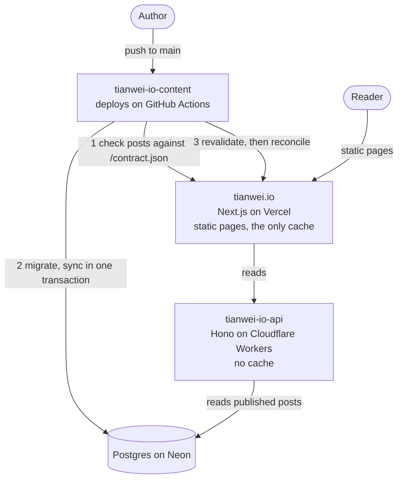

<!-- markdownlint-disable MD007 MD033 MD041 -->
<samp>
<h1>tianwei.io</h1>

[](https://github.com/notbd/tianwei.io/actions/workflows/ci.yml)

The frontend layer of my personal website [tianwei.io](https://tianwei.io).

<h2>Stack</h2>

- **Framework**: [Next.js](https://nextjs.org) (App Router)
- **Styling**: [Tailwind CSS](https://tailwindcss.com)
- **MDX Processing**: [MDX](https://mdxjs.com) (`@mdx-js/mdx`) with remark/rehype plugins and [rehype-pretty-code](https://rehype-pretty.pages.dev)
- **Data Validation**: [Zod](https://zod.dev)
- **Image Optimization**: [Cloudinary](https://cloudinary.com)
- **Testing**: [Vitest](https://vitest.dev) (unit/contract) + [Playwright](https://playwright.dev) (browser smoke)
- **Deployment**: [Vercel](https://vercel.com)

<h2>Site Architecture</h2>

The site is split into three repos, each deployed on its own:

- **[Frontend](https://github.com/notbd/tianwei.io)** (this repo): a Next.js app on Vercel that serves every page as static HTML; the pages that show posts are built from data it fetches through the API.
- **[API Layer](https://github.com/notbd/tianwei-io-api)**: a read-only REST API on Cloudflare Workers that serves the published posts from Postgres.
- **[Content Engine](https://github.com/notbd/tianwei-io-content)**: the posts themselves, written in MDX, validated and synced into Postgres on Neon.

Three services is more than a personal site needs. I split it on purpose, to practice what only exists between services: API contracts, independent deploys and cache invalidation across repos ([ADR-0001](./docs/adr/0001-three-tier-architecture.md)).



This repo's data cache is the only cache in the system, so new content shows on the site once it is expired. The content engine's deploy expires it after every sync, then checks every page; the steps are in [its README](https://github.com/notbd/tianwei-io-content/blob/main/README.md) (Deploy).

<h2>How It Works</h2>

- **Static pages, refreshed on demand**: the home page, the post list, every post and category page, the RSS feed, the sitemap and each post's Open Graph image are generated at build time. Their API fetches are cached under one tag, `posts`, that never expires on a timer; only a revalidation refreshes them ([ADR-0002](./docs/adr/0002-single-cache-layer.md)).
- **Resilient fetching**: every API request has a 10 s deadline and is retried on network errors, timeouts and 5xx (3 attempts with backoff), so a brief API failure delays a render instead of breaking it, and a hung API fails it in about 30 s instead of never. A build refuses an empty post list. A post page is a 404 when its slug is not in the cached post list (so a made-up URL never reaches the API) or when the API says the post does not exist; any other failure is an error, not a 404.
- **Posts hold to a contract**: posts are compiled on the server with `@mdx-js/mdx`. A body is Markdown plus the components listed in [`/contract.json`](https://tianwei.io/contract.json), with string attributes their schemas accept; imports, exports, `{expressions}` and any other JSX are refused, so a post can never run code on the server. The content engine checks every post against the same contract before it syncs ([ADR-0006](./docs/adr/0006-cross-repo-releases.md)).
- **Each post page reports its body's hash**: exactly one `post-body-sha256` meta tag, rendered from the post the page renders. On Vercel a page that fails to re-render keeps serving its old version with a 200, so the content deploy compares this hash with the body it just synced to prove the new version is live ([ADR-0006](./docs/adr/0006-cross-repo-releases.md)).
- **Cookie-free theme**: an inline script applies the saved light or dark theme before the first paint, so no page has to render per request ([ADR-0003](./docs/adr/0003-cookie-free-theme.md)).
- **One time zone**: dates display in `America/New_York`, the zone the content engine anchors them to ([ADR-0004](./docs/adr/0004-display-time-zone.md)).
- **Draft preview**: `/api/preview?secret=<PREVIEW_SECRET>&slug=<slug>` turns on Next.js draft mode and renders an unpublished post through the API's preview endpoint; `/api/preview/disable` turns it off.

<h2>Local Run</h2>

Prerequisites: **Node.js 26** (see `.nvmrc`) and **pnpm 10**.

```shell
git clone git@github.com:notbd/tianwei.io.git
cd tianwei.io
pnpm install
cp .env.example .env.local   # the defaults work as-is against the production API
pnpm dev
```

To run against a local API and database instead of production, see [the content engine's README](https://github.com/notbd/tianwei-io-content/blob/main/README.md) (Local Run); the ports and addresses are written there once.

<h2>Configuration</h2>

| Variable | Purpose |
| --- | --- |
| `CONTENT_API_URL` | The API's base URL (`https://tio.twz.app`, public and read-only) |
| `NEXT_PUBLIC_CLOUDINARY_CLOUD_NAME` | The Cloudinary account that hosts post images; post images are Cloudinary public ids, so the build fails without it |
| `REVALIDATION_SECRET` | Bearer token for `/api/revalidate`; must match the content engine's |
| `PREVIEW_SECRET` (optional) | Enables draft preview; must match the API's |

<h2>Quality Gates</h2>

```shell
pnpm lint        # type-aware ESLint
pnpm typecheck
pnpm test        # Vitest: unit and contract tests
pnpm build
pnpm test:e2e    # Playwright smoke tests against the production build
```

`pnpm test:e2e` needs Chromium once per Playwright version: `pnpm exec playwright install chromium`. CI (`.github/workflows/ci.yml`) runs all five on every pull request and on pushes to `main`, with no secrets: the two values the build needs are public and inlined in the workflow.

<h2>Deploy</h2>

Vercel deploys `main` to production and every other branch to a preview URL. Content changes never need a frontend deploy; they arrive through `/api/revalidate`. Which repo ships first when a change spans repos, and how to recover the content deploy after a rollback of this repo, is in [ADR-0006](./docs/adr/0006-cross-repo-releases.md). The release checklist is [`docs/release-verification.md`](./docs/release-verification.md); design records are in [`docs/adr/`](./docs/adr/).

<h2>Revalidation API</h2>

`POST /api/revalidate` reads the post list, every post and the categories straight from the API, through the schemas the pages use, and expires the `posts` tag only when every read works ([why](./docs/adr/0006-cross-repo-releases.md)). The content engine's deploy calls it after every sync:

```shell
curl -X POST https://tianwei.io/api/revalidate \
  -H "Authorization: Bearer $REVALIDATION_SECRET" \
  -H "Content-Type: application/json" \
  -d '{"tags": ["posts"]}'
```

- **Body**: exactly `{"tags": ["posts"]}`. Every fetch carries the `posts` tag, so expiring it refreshes the whole site.
- **Response**: any status not listed here counts as a failure.

| Status | Meaning | Body |
| --- | --- | --- |
| `200` | `posts` is expired | `{"success": true, "revalidated": ["posts"]}` |
| `400` | Any other body | `{"error": ...}` |
| `401` | No bearer, a wrong one, or no `REVALIDATION_SECRET` configured | `{"error": "Unauthorized"}` |
| `502` | A read failed, or the reads, retries included, took more than 25 s. **Nothing was expired** | `{"error": ..., "message": ...}` |

<h2>License</h2>

Source code is licensed under <a href='./LICENSE'>AGPLv3</a>.<br>
Posts (in <a href='https://github.com/notbd/tianwei-io-content'>tianwei-io-content</a>) are licensed under <a href='https://creativecommons.org/licenses/by-nc-sa/4.0/'>CC BY-NC-SA 4.0</a>.
</samp>
