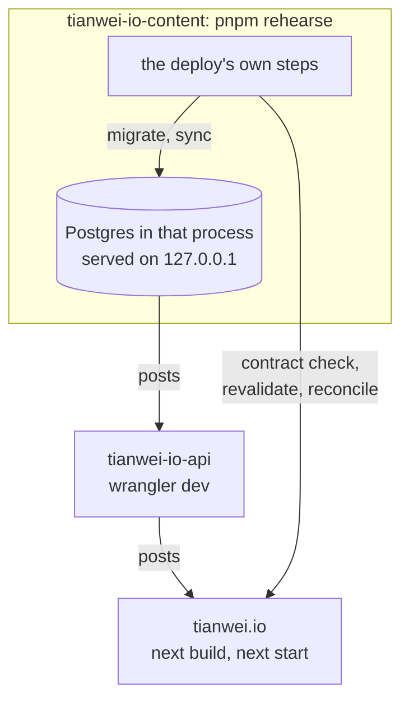

# Release verification: rehearse the whole chain before any merge to main

Goal: everything that reaches `main` has been exercised end to end
(content, database, API, frontend, browser) and **manually signed off**.
Nothing here touches production data or production traffic.

## The rehearsed stack



Everything runs on this machine, on `127.0.0.1`, from the three
checkouts as they are on disk. The database is built in memory from the
content engine's migrations and files, so there is nothing to create or
clean up ([its ADR-0004](https://github.com/notbd/tianwei-io-content/blob/main/docs/adr/0004-in-process-local-database.md)).

## Steps

### 1. Rehearse the release

Put the three checkouts, side by side, on what is about to ship. In each
of `tianwei-io-content`, `tianwei-io-api` and `tianwei.io`:

```shell
git fetch
git switch --detach origin/<the branch to release>   # --detach: another worktree may hold the branch
pnpm install
```

Before starting:

- Nothing else may be using the frontend checkout's production build: no
  `next start`, screenshots or e2e there. The rehearsal replaces it.
- The frontend's `.env.local` has `NEXT_PUBLIC_CLOUDINARY_CLOUD_NAME`.
  Without it the build fails and names the variable.

Then, in the content engine:

```shell
cd tianwei-io-content
pnpm rehearse --keep
```

It starts the stack and plays a content deploy against it: the contract
check, a sync, the revalidation, the reconcile of every page, and the
failures a deploy must catch (an API that cannot read the database, a
post that passes the contract but fails to render). What it does, what
it needs and how to stop it are in
[the content engine's README](https://github.com/notbd/tianwei-io-content/blob/main/README.md)
(Rehearsing a release).

Expect `Every scenario passed`, then the addresses of the stack it now
holds, both secrets and a draft's slug. Leave it running for steps 2
and 3. A run that fails prints the scenario, the reason and the last
lines each service logged, and exits non-zero.

### 2. Browser tests against the held stack

```shell
cd tianwei.io
CONTENT_API_URL=<the API address it printed> pnpm test:e2e
```

Port 3000 must be free: Playwright starts its own `next start` there on
the build the rehearsal made, and with another server already on that
port it would test that one without saying so.

### 3. Manual sign-off checklist

On the frontend address the rehearsal printed:

- [ ] Home, /posts, each post render; dates show the authored day (ET)
- [ ] Theme toggle cycles and survives reload
- [ ] /feed.xml valid, /sitemap.xml lists posts + categories
- [ ] /categories/<name> filters correctly
- [ ] A post's `opengraph-image` renders (append `/opengraph-image` to its URL)
- [ ] Draft preview: `/api/preview?secret=<the PREVIEW_SECRET it printed>&slug=<the draft it printed>`
      shows the banner; `/api/preview/disable` exits

Then press Ctrl-C in the rehearsal's terminal; it stops the stack and
cleans up after itself.

### 4. Compare with production (only for some releases)

Do this when the release changes the API, the table's schema, or the
content engine's sync or database code. `pnpm smoke` compares the same
data under the old code and the new, so it needs a database with
production's data: a **Neon branch**, a copy-on-write fork of the
production database (Neon console: Branches, New branch from `main`,
copy its connection string; below `<branch>`).

```shell
cd tianwei-io-content
DATABASE_URL=<branch> pnpm db:migrate     # applies pending migrations
DATABASE_URL=<branch> pnpm sync:prod      # the transactional sync

cd ../tianwei-io-api
# .dev.vars: DATABASE_URL=<branch>, NODE_ENV=production
pnpm dev                                  # wrangler dev on http://127.0.0.1:8787
pnpm smoke https://tio.twz.app http://127.0.0.1:8787
```

Expect 11/11. `pnpm smoke` compares the parsed JSON of the two (key
order ignored, the `/health` body skipped), so it passes only when the
release carries no content change; with content changes, run it before
the sync or read the diff as the expected content delta. One mismatch on
`/api/__dev/posts` means `.dev.vars` has `NODE_ENV=development`
(production answers 404 there).

This is also the only time before a release that `pnpm sync:prod` and
its `pg` driver run against a real database.

### 5. Merge (only after sign-off)

Merge one repo at a time, in the order
[ADR-0006](./adr/0006-cross-repo-releases.md) gives for what the release
changes, and let each deploy finish before the next merge. A release
that changes the frontend's contract (a new MDX component, say) merges
the frontend first, and the content engine only once
`https://tianwei.io/contract.json` serves the new contract. What the
content deploy does and checks is in the Deploy section of
[its README](https://github.com/notbd/tianwei-io-content/blob/main/README.md).

Merging is always a human action on the PR page. Each repo's CI must be
green: lint, typecheck and tests in all three, plus the build and
Playwright in the frontend, the contract check in the content engine and
the deploy script's check in the API. This runbook does not repeat them.
Green CI is necessary, not sufficient: this runbook is the sufficient
part.

Optional hardening: GitHub → Settings → Branches → protect `main`
(require PR + passing checks) on all three repos, so nothing can land
without going through this flow.

## Cleanup

Only after step 4: delete or reset the Neon branch (Branches → … →
Reset from parent) so the next comparison starts from fresh production
data. The rehearsal leaves nothing behind.
