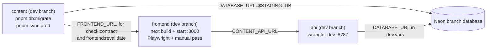

# Release verification: full-chain staging before any merge to main

Goal: everything that reaches `main` has been exercised end-to-end
(content → database → API → frontend → browser) and **manually signed
off**. Nothing here touches production data or production traffic.

## The staging chain



The one piece of infrastructure needed: a **Neon branch**: a
copy-on-write fork of the production database (free, instant, safe to
migrate and wipe). Create once in the Neon console: Branches → New branch
from `main` → copy its connection string (below: `$STAGING_DB`).

## Steps (run in order, each from its own repo)

### 1. Content engine → staging DB

```shell
cd tianwei-io-content   # dev branch
pnpm install && pnpm lint && pnpm typecheck && pnpm test

DATABASE_URL=$STAGING_DB pnpm db:migrate     # applies pending migrations
DATABASE_URL=$STAGING_DB pnpm sync:prod      # transactional reconcile
```

Expect: `Completed: N upserted, M deleted`. Spot-check a row in the Neon
SQL console: `created_at` values are ET-midnight instants (04:00/05:00 UTC).

### 2. API → local Worker on the staging DB

```shell
cd tianwei-io-api       # dev branch
pnpm install && pnpm lint && pnpm typecheck && pnpm test

# .dev.vars: DATABASE_URL=$STAGING_DB, NODE_ENV=production (+ PREVIEW_SECRET=... to test previews)
pnpm dev                 # wrangler dev on http://127.0.0.1:8787
```

Contract check against live production. `pnpm smoke` compares the parsed
JSON of two deployments (key order ignored, the `/health` body skipped), so
it only passes when this release carries no content change; with content
changes, run it before step 1's sync or read the diff as the expected
content delta:

```shell
pnpm smoke https://tio.twz.app http://127.0.0.1:8787
```

Expect 11/11. One mismatch on `/api/__dev/posts` means the local
`.dev.vars` has `NODE_ENV=development` (the value `.dev.vars.example` ships
with; production answers 404 there). Set `NODE_ENV=production` in
`.dev.vars` and restart `pnpm dev` for a clean comparison.

### 3. Frontend → against the local Worker

```shell
cd tianwei.io           # dev branch
pnpm install && pnpm lint && pnpm typecheck && pnpm test

CONTENT_API_URL=http://127.0.0.1:8787 pnpm build
CONTENT_API_URL=http://127.0.0.1:8787 pnpm test:e2e   # Playwright smoke
CONTENT_API_URL=http://127.0.0.1:8787 pnpm start      # manual pass
```

### 4. Manual sign-off checklist (http://localhost:3000)

- [ ] Home, /posts, each post render; dates show the authored day (ET)
- [ ] Build output listed every post under `● /posts/[slug]` (none dropped)
- [ ] Theme toggle cycles and survives reload
- [ ] /feed.xml valid, /sitemap.xml lists posts + categories
- [ ] /categories/<name> filters correctly
- [ ] A post's `opengraph-image` renders (append `/opengraph-image` to its URL)
- [ ] Draft preview: `/api/preview?secret=...&slug=<slug>` shows the banner; `/api/preview/disable` exits
- [ ] Contract: in the content repo,
      `FRONTEND_URL=http://localhost:3000 pnpm check:contract` passes
- [ ] Revalidation round-trip: re-run step 1's sync with an edited post,
      then in the content repo run
      `FRONTEND_URL=http://localhost:3000 pnpm frontend:revalidate` (its
      `REVALIDATION_SECRET` must equal the one in this repo's
      `.env.local`). It revalidates twice, a minute apart, then
      reconciles, and passes only when each post page shows the synced
      body

### 5. Merge (only after sign-off)

Merge one repo at a time, in the order
[ADR-0006](./adr/0006-cross-repo-releases.md) gives for what the release
changes, and let each deploy finish before the next merge. A release
that changes the frontend's contract (a new MDX component, say) merges
the frontend first, and the content engine only once
`https://tianwei.io/contract.json` serves the new contract. What the
content deploy does and checks is in the Deploy section of
[its README](https://github.com/notbd/tianwei-io-content/blob/main/README.md).

Merging is always a human action on the PR page: CI gates (lint,
typecheck, tests, build, Playwright) must be green, but green CI is
necessary, not sufficient: this runbook is the sufficient part.

Optional hardening: GitHub → Settings → Branches → protect `main`
(require PR + passing checks) on all three repos, so nothing can land
without going through this flow.

## Cleanup

Delete or reset the Neon branch afterwards (Branches → … → Reset from
parent) so the next verification starts from fresh production data.
